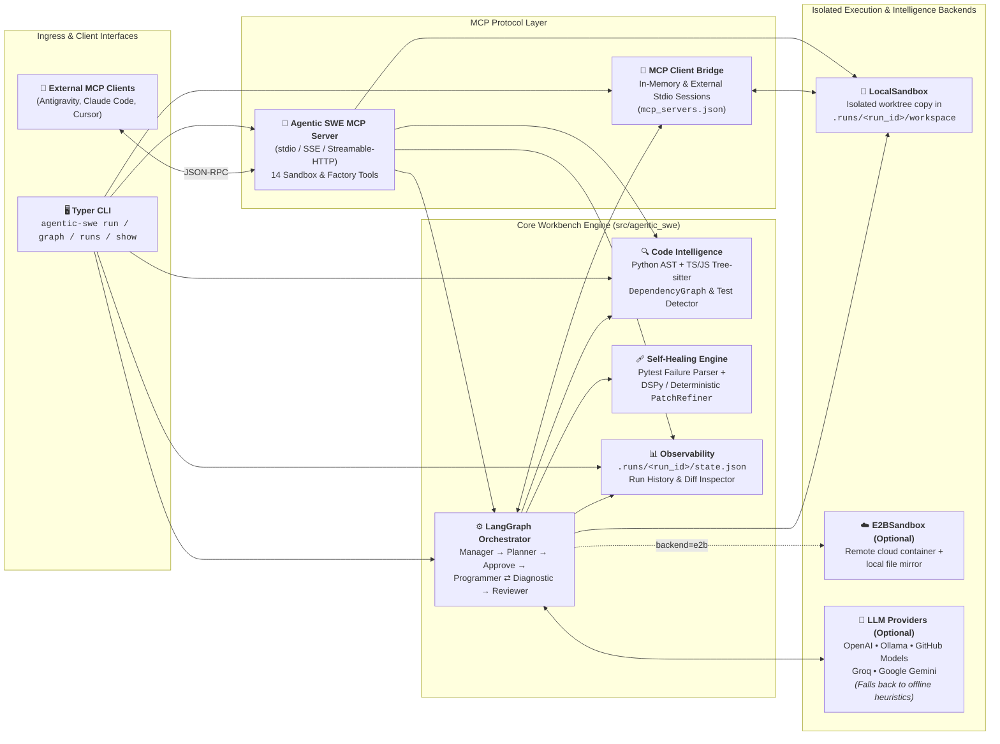

# Agentic SWE Workbench

**Agentic SWE Workbench** is a local-first, multi-agent software engineering factory inspired by [Open SWE](https://github.com/langchain-ai/open-swe) and [MetaGPT](https://github.com/geekan/MetaGPT).

Given a natural-language issue ticket and a target repository, the workbench automatically **indexes the codebase**, **drafts an execution plan** (with optional human-in-the-loop approval), **clones the repository into an isolated sandbox**, **synthesizes code patches**, **runs the test suite**, **self-heals failing tests** through an iterative diagnostic loop, and **verifies patch quality** via an independent Reviewer agent before marking the run as succeeded.

It is designed to run **100% locally and offline out of the box** (using deterministic heuristics for instant smoke testing and CI verification) while seamlessly scaling up to **LLM-powered structured generation and MCP tool-calling** across OpenAI, Ollama, GitHub Models, Groq, and Google Gemini.

---

## Table of Contents

1. [Why Agentic SWE Workbench?](#why-agentic-swe-workbench)
2. [End-to-End Workflow Diagram](#end-to-end-workflow-diagram)
3. [System Architecture Diagram](#system-architecture-diagram)
4. [How It Works: Step-by-Step Lifecycle](#how-it-works-step-by-step-lifecycle)
5. [Core Subsystems](#core-subsystems)
6. [Quick Start & Installation](#quick-start--installation)
7. [CLI Usage & Examples](#cli-usage--examples)
8. [Model Context Protocol (MCP) Integration](#model-context-protocol-mcp-integration)
9. [Configuration & Environment Variables](#configuration--environment-variables)
10. [Repository Layout](#repository-layout)

---

## Why Agentic SWE Workbench?

Traditional coding assistants operate directly on your working tree in a single unstructured loop. **Agentic SWE Workbench** treats software resolution as a structured, observable engineering pipeline with strict guardrails:

- **Zero-Risk Isolated Sandboxes**: Every ticket run copies the target repository into `.runs/<run_id>/workspace` (or syncs to an optional **E2B cloud sandbox**). Your source repository is never mutated directly.
- **Graph-Guided Context (No Full-Repo Dumps)**: Before planning, a multi-language indexer parses Python (`ast`) and TypeScript/JavaScript (`tree-sitter` or regex fallback) into a symbol & import `DependencyGraph`, selecting only relevant candidate files.
- **Human-in-the-Loop (HITL) Governance**: Using LangGraph checkpoints and interrupts, runs can pause after planning (`awaiting_approval`) so a human engineer or external supervisor can approve, reject, or attach feedback before a single file is written.
- **Bounded Self-Healing**: When tests fail, the **Diagnostic** agent parses stack traces and assertion failures, refines a targeted repair brief (via deterministic rules or **DSPy** signatures), and re-invokes patch synthesis—strictly bounded by `max_heal_attempts` and `max_files_touched`.
- **Independent Quality Gate**: Passing tests alone is not enough. A dedicated **Reviewer** agent inspects the applied patches and test output to ensure tests were not deleted or hollowed out (`assert`-stripped) before approving the run.
- **Dual-Surface MCP Native**: Acts as both an **MCP Server** (exposing 14 sandbox, code-intel, and factory tools over `stdio`, `sse`, or `streamable-http` to IDEs like Cursor, Claude Code, and Antigravity) and an **MCP Client** (allowing the internal Programmer agent to call sandbox and external MCP tools in a ReAct loop).

---

## End-to-End Workflow Diagram

```mermaid
flowchart TD
    Start(["🎫 Input: CLI Ticket or MCP Tool Call<br/>(repo_path + natural-language ticket)"]) --> Manager

    subgraph Orchestrator ["LangGraph Multi-Agent Factory (StateGraph)"]
        direction TB

        Manager["<b>1. Manager Node</b><br/>• Create isolated sandbox (.runs/&lt;run_id&gt;/workspace)<br/>• Normalize ticket & acceptance criteria<br/>• Status → <code>PLANNING</code>"]

        Planner["<b>2. Planner Node</b><br/>• Index repo symbols & imports (Python AST + TS/JS)<br/>• Auto-detect test command (pytest / npm test)<br/>• Rank candidate files via keyword/symbol graph search<br/>• Draft <code>EditPlan</code> (LLM structured output or heuristic)"]

        ApproveGate{"<b>3. Approve Node (HITL Gate)</b><br/><code>auto_approve == True</code>?"}

        Interrupt["⏸️ <b>LangGraph Interrupt</b><br/>• Status → <code>AWAITING_APPROVAL</code><br/>• Prompt stdin (<code>--interactive</code>) or resume via<br/>  <code>agentic-swe approve &lt;run_id&gt;</code>"]

        Decision{"Plan Approved?"}

        Programmer["<b>4. Programmer Node</b><br/>• Status → <code>CODING</code><br/>• Synthesize <code>PatchSet</code> via:<br/>  1) LLM + MCP Tool-Calling Loop, or<br/>  2) LLM Structured Output, or<br/>  3) Offline Heuristic Patcher<br/>• Enforce <code>max_files_touched</code> cap & write to sandbox"]

        RunTests["<b>Sandbox Test Execution</b><br/>• Status → <code>TESTING</code><br/>• Run detected <code>test_command</code> in sandbox<br/>• Capture exit code, stdout, stderr & duration"]

        TestCheck{"Tests Passed?<br/>(<code>exit_code == 0</code>)"}

        BudgetCheck{"Heal Attempts &lt;<br/><code>max_heal_attempts</code>?"}

        Diagnostic["<b>5. Diagnostic Node (Self-Healing)</b><br/>• Status → <code>HEALING</code><br/>• Parse failing tests & assertion hints<br/>• Refine repair brief (<code>PatchRefiner</code> / DSPy)<br/>• Synthesize & apply repair patches<br/>• Re-run sandbox test suite"]

        DiagTestCheck{"Repair Tests<br/>Passed?"}

        Reviewer["<b>6. Reviewer Node</b><br/>• Status → <code>REVIEWING</code><br/>• Verify diff minimalism & ticket alignment<br/>• Guard against test deletion or hollowed assertions<br/>• Produce <code>ReviewResult</code> (LLM or heuristic)"]

        ReviewCheck{"Reviewer<br/>Approved?"}

        ReviewBudget{"Review Count &lt;<br/><code>max_heal_attempts</code>?"}
    end

    Aborted(["🛑 <b>RunStatus.ABORTED</b><br/>Plan rejected by human reviewer"])
    Failed(["❌ <b>RunStatus.FAILED</b><br/>Heal or review budget exhausted"])
    Succeeded(["✅ <b>RunStatus.SUCCEEDED</b><br/>Verified patches in .runs/&lt;run_id&gt;/workspace"])

    Manager --> Planner
    Planner --> ApproveGate
    ApproveGate -- "Yes (Auto)" --> Programmer
    ApproveGate -- "No (HITL)" --> Interrupt
    Interrupt --> Decision
    Decision -- "Approved (+ optional feedback)" --> Programmer
    Decision -- "Rejected" --> Aborted

    Programmer --> RunTests
    RunTests --> TestCheck
    TestCheck -- "Yes (Green)" --> Reviewer
    TestCheck -- "No (Failed)" --> BudgetCheck

    BudgetCheck -- "Yes" --> Diagnostic
    BudgetCheck -- "No (Exhausted)" --> Failed

    Diagnostic --> DiagTestCheck
    DiagTestCheck -- "Yes (Green)" --> Reviewer
    DiagTestCheck -- "No (Still Failing)" --> BudgetCheck

    Reviewer --> ReviewCheck
    ReviewCheck -- "Yes" --> Succeeded
    ReviewCheck -- "No (Requested Changes)" --> ReviewBudget
    ReviewBudget -- "Yes (Send revision_brief)" --> Programmer
    ReviewBudget -- "No (Exhausted)" --> Failed
```

The orchestrator (`src/agentic_swe/orchestrator/graph.py`) is implemented as a compiled **LangGraph `StateGraph`** with an in-memory checkpointer (`MemorySaver`). Every node transition persists the full `RunState` to `.runs/<run_id>/state.json`.



---

## System Architecture Diagram

The diagram below illustrates how the CLI, MCP server/client bridge, LangGraph orchestrator, code intelligence indexer, self-healing engine, LLM providers, and sandbox backends fit together:



---

## How It Works: Step-by-Step Lifecycle

1. **Ticket Ingestion (`Manager`)**:
   - Accepts a `Ticket` (`title`, `description`, `acceptance_criteria`).
   - Provisions a fresh sandbox via `SandboxManager` by copying the target repository (excluding `.git`, `.venv`, `node_modules`, `__pycache__`, etc.) into `.runs/run_<id>/workspace`.
2. **Codebase Indexing & Blueprinting (`Planner`)**:
   - Builds a `DependencyGraph` across Python and TypeScript/JavaScript files, recording modules, classes, functions, line numbers, docstrings, and import edges.
   - Infers the project's test command (`pytest -q` via `pyproject.toml`/`pytest.ini` or `npm test` via `package.json`).
   - Queries the dependency graph using ticket keywords to identify candidate source files without overflowing LLM context windows.
   - Generates a structured `EditPlan` containing ordered `PlanStep` items, target files, risks, and the test command.
3. **Plan Approval Gate (`Approve`)**:
   - When `--auto-approve` is enabled (default), the plan is immediately approved and execution proceeds to coding.
   - When `--no-auto-approve` is passed, LangGraph triggers an `interrupt()`. You can either approve/reject interactively on stdin (`--interactive`), pass `--approve`/`--reject --feedback "..."` non-interactively, or let the run pause in `awaiting_approval` status (exit code `2`).
4. **Patch Synthesis & Application (`Programmer`)**:
   - Generates file modifications (`PatchSet`) using one of three strategies:
     1. **MCP ReAct Tool-Calling Loop (`--mcp-tools`)**: The LLM inspects files, searches symbols, writes edits, and runs tests via LangChain-wrapped MCP tools.
     2. **Structured Output Mode**: The LLM receives the target file contents, plan summary, and any repair/revision brief, returning a validated `PatchSet`.
     3. **Offline Heuristic Fallback**: When no API key or local LLM is configured, deterministic rules patch known fixture patterns so tests and demos work offline.
   - Enforces the `max_files_touched` guardrail (default: `8`) and executes the test command inside the sandbox.
5. **Iterative Self-Healing (`Diagnostic`)**:
   - If the test command exits non-zero, the run enters `HEALING` status.
   - `diagnose_failure()` extracts failing test identifiers (`FAILED`/`ERROR`) and `AssertionError` hints from stdout/stderr.
   - `PatchRefiner` refines the repair instructions based on the failure context and prior attempt count (using `dspy.Predict` when enabled or deterministic tightening).
   - The `Diagnostic` node generates new patches, applies them to the sandbox, and re-runs the test suite. This loop repeats until tests pass or `max_heal_attempts` (default: `5`) is reached.
6. **Verification Gate (`Reviewer`)**:
   - Once tests are green (`exit_code == 0`), the `Reviewer` node audits the changes.
   - Checks that planned target files exist, diffs are minimal, and test files in `tests/` were neither deleted nor stripped of `assert` statements.
   - If rejected, the Reviewer attaches a `revision_brief` and routes the state back to the `Programmer` node for another pass. If approved, the run finishes with `RunStatus.SUCCEEDED`.

---

## Core Subsystems

| Subsystem | Location | Key Responsibilities |
| :--- | :--- | :--- |
| **CLI** | `src/agentic_swe/cli.py` | Typer + Rich CLI providing `run`, `approve`, `graph`, `runs`, `show`, `mcp`, `mcp-tools`, `mcp-agent`, and `version` commands. |
| **Orchestrator** | `src/agentic_swe/orchestrator/` | LangGraph state machine (`graph.py`) and agent node implementations (`agents.py`) for Manager, Planner, Approve, Programmer, Diagnostic, and Reviewer. |
| **Code Intelligence** | `src/agentic_swe/code_intel/` | Multi-language repository indexer (`indexer.py`, `typescript.py`), `DependencyGraph` query engine (`graph.py`), and language/test-runner detector (`detect.py`). |
| **Sandboxes** | `src/agentic_swe/sandbox/` | `Sandbox` protocol (`protocol.py`), path-jailed local worktree execution (`local.py`), cloud sandbox adapter (`e2b_backend.py`), and `SandboxManager` (`manager.py`). |
| **MCP Server & Client** | `src/agentic_swe/sandbox/mcp_server.py`<br/>`src/agentic_swe/mcp_client.py` | FastMCP/MCPServer exposing 14 tools over `stdio`/`sse`/`streamable-http`, plus `MCPClientBridge` for in-memory and external `mcp_servers.json` tool invocation. |
| **Self-Healing** | `src/agentic_swe/healing/` | Test output parser (`diagnostic.py`) and DSPy/deterministic repair brief refiner (`dspy_modules.py`). |
| **LLM Layer** | `src/agentic_swe/llm.py` | Multi-provider OpenAI-compatible client factory (`create_chat_model`), Pydantic `structured_generate`, and bounded `run_tool_calling_agent` loop. |
| **Observability** | `src/agentic_swe/observability.py` | Reads persisted `.runs/<run_id>/state.json` artifacts to list run summaries, inspect message logs, and compute changed files. |

---

## Quick Start & Installation

### Prerequisites
- **Python ≥ 3.11** (3.11 or 3.12 recommended)
- **Node.js ≥ 18** *(optional, only required to run the TypeScript/JavaScript fixture `examples/fixture_ts`)*

### 1. Clone & Install

**Windows (PowerShell):**
```powershell
git clone <your-repo-url> Agentic.SWE.Workbench
cd Agentic.SWE.Workbench

python -m venv .venv
.\.venv\Scripts\Activate.ps1
pip install -e ".[dev]"
```

**macOS / Linux (Bash / Zsh):**
```bash
git clone <your-repo-url> Agentic.SWE.Workbench
cd Agentic.SWE.Workbench

python3 -m venv .venv
source .venv/bin/activate
pip install -e ".[dev]"
```

### 2. Install Optional Extras

```bash
# Enable LLM-backed agents (LangChain OpenAI client + DSPy)
pip install -e ".[llm]"

# Enable native Tree-sitter AST parsing for Python & TypeScript
pip install -e ".[treesitter]"

# Enable E2B cloud sandbox execution backend
pip install -e ".[e2b]"
```

### 3. Verify Installation

Run the test suite to verify all subsystems (sandbox, code-intel, orchestrator, healing, reviewer, and MCP client/server):

```bash
pytest
```

---

## CLI Usage & Examples

### 1. Run the Multi-Agent Factory (`agentic-swe run`)

Run against the included Python or TypeScript/JavaScript fixtures (works **offline** right away using heuristic mode, or uses your configured LLM when an API key / Ollama is active):

```bash
# Python fixture (runs pytest inside .runs/<run_id>/workspace)
agentic-swe run -r examples/fixture_repo -t "fix add so that 2+2 equals 4"

# TypeScript/JS fixture (auto-detects package.json and runs npm test)
agentic-swe run -r examples/fixture_ts -t "fix add so that 2+2 equals 4"
```

### 2. Human-in-the-Loop (HITL) Plan Approval

Pause execution after the Planner agent drafts an `EditPlan` so you can inspect steps and risks before any files are modified:

```bash
# Pause after planning (persists run in awaiting_approval state and prints <run_id>)
agentic-swe run -r examples/fixture_repo -t "fix add" --no-auto-approve

# Resume a paused run by run_id (approve or reject)
agentic-swe approve <run_id> --approve --feedback "Looks good, proceed"
agentic-swe approve <run_id> --reject --feedback "Abort this change"

# Interactive mode: prompts [y/N] and optional feedback directly on stdin
agentic-swe run -r examples/fixture_repo -t "fix add" --no-auto-approve --interactive

# Single-command non-interactive approval or rejection
agentic-swe run -r examples/fixture_repo -t "fix add" --no-auto-approve --approve --feedback "Keep changes restricted to calculator.py"
```

### 3. Use With Free / Local / Cloud LLM Providers

Install `pip install -e ".[llm]"` and choose your provider via `--provider` (or environment variables):

```bash
# Local Ollama (no API key needed; defaults to http://localhost:11434/v1)
export OPENAI_MODEL="qwen2.5-coder:7b"
agentic-swe run -r examples/fixture_repo -t "fix add" --provider ollama --mcp-tools

# OpenAI
export OPENAI_API_KEY="sk-..."
agentic-swe run -r examples/fixture_repo -t "fix add" --provider openai

# GitHub Models / Groq / Google Gemini (OpenAI-compatible endpoints)
export OPENAI_API_KEY="<your-provider-token>"
agentic-swe run -r examples/fixture_repo -t "fix add" --provider github
agentic-swe run -r examples/fixture_repo -t "fix add" --provider groq
agentic-swe run -r examples/fixture_repo -t "fix add" --provider gemini
```

### 4. Inspect Code Intelligence Graph (`agentic-swe graph`)

Index any Python or TypeScript/JavaScript repository and view its symbol count, import edge count, detected languages, and sample symbols:

```bash
agentic-swe graph examples/fixture_repo
agentic-swe graph examples/fixture_ts
```

### 5. Inspect Past Runs (`agentic-swe runs` & `agentic-swe show`)

Every run stores its complete state and isolated workspace under `.runs/<run_id>/`:

```bash
# List recent runs with status, heal attempts, and review counts
agentic-swe runs

# Show detailed metadata, changed files, and agent message log for a specific run
agentic-swe show <run_id>
```

### 6. Gold-Patch Evaluation Harness & Docker Sandboxing (`agentic-swe eval`)

Run reproducible benchmark tasks with deterministic command-safety enforcement (`strict`, `standard`, or `off`) and optional hardened Docker container isolation (`--network=none`, `--cap-drop=ALL`, `--read-only`):

```bash
# Run gold-patch evaluation suite locally under strict command-safety policy
agentic-swe eval --tasks evals/tasks.json --policy strict --output eval-report.json

# Build the hardened sandbox container image and run evals inside Docker
docker build -t agentic-swe-sandbox:latest .
agentic-swe eval --tasks evals/tasks.json --backend docker --policy strict --output docker-eval-report.json
```

For remote/ephemeral cloud execution, see the optional AWS/Terraform runner in [`infra/aws/README.md`](infra/aws/README.md). Every push and pull request is verified by [`.github/workflows/ci.yml`](.github/workflows/ci.yml) across Python 3.11/3.12 lint & unit tests, gold-patch evaluation, Docker sandbox smoke testing, and Terraform validation.

---

## Model Context Protocol (MCP) Integration

Agentic SWE Workbench includes a full **MCP Server** (`src/agentic_swe/sandbox/mcp_server.py`) and **MCP Client Bridge** (`src/agentic_swe/mcp_client.py`).

### Starting the MCP Server

```bash
# Default stdio transport (for Claude Desktop, Claude Code, Cursor, Antigravity)
agentic-swe mcp

# SSE or Streamable-HTTP transport for networked / remote agents
agentic-swe mcp --transport sse --host 127.0.0.1 --port 8000
agentic-swe mcp --transport streamable-http --host 127.0.0.1 --port 8000
```

To register the server in an MCP client configuration (`mcp_servers.json` / `claude_desktop_config.json`):

```json
{
  "mcpServers": {
    "agentic-swe": {
      "command": "agentic-swe",
      "args": ["mcp"]
    }
  }
}
```

### Exposed MCP Tools (14 Tools)

You can inspect all available tools at any time via `agentic-swe mcp-tools`:

| Category | Tool Name | Description |
| :--- | :--- | :--- |
| **Sandbox (Low-Level)** | `sandbox_create` | Create an isolated local sandbox worktree from `repo_path`. |
| **Sandbox (Low-Level)** | `sandbox_list_files` | List files inside the active sandbox matching a glob pattern. |
| **Sandbox (Low-Level)** | `sandbox_read_file` | Read UTF-8 file contents from the active sandbox. |
| **Sandbox (Low-Level)** | `sandbox_write_file` | Write file contents inside the active sandbox. |
| **Sandbox (Low-Level)** | `sandbox_run` | Execute an arbitrary shell command inside the active sandbox. |
| **Sandbox (Low-Level)** | `sandbox_run_tests` | Run the test suite inside the active sandbox and return pass/fail + output. |
| **Sandbox (Low-Level)** | `sandbox_destroy` | Delete the active sandbox worktree. |
| **Code Intelligence** | `code_intel_graph` | Index a repo (Python + TS/JS) and query symbols, keywords, and test commands. |
| **Factory & Agents** | `agent_plan` | Run the Planner agent read-only on a repo to generate a structured `EditPlan`. |
| **Factory & Agents** | `agent_diagnose` | Run the Diagnostic + `PatchRefiner` agent on failing test output. |
| **Factory & Agents** | `factory_run` | Run the full multi-agent pipeline (`Manager → Planner → Programmer → Diagnostic → Reviewer`). |
| **Factory & Agents** | `factory_approve` | Resume a paused `awaiting_approval` run by `run_id` (or execute a run with an explicit HITL approval/rejection decision). |
| **Observability** | `runs_list` | List recent persisted factory runs from `.runs/`. |
| **Observability** | `runs_show` | Load full state, test results, reviews, and messages for a specific `run_id`. |

### End-to-End MCP Agent Session Demo

To see an external agent drive a complete ticket resolution over a live MCP `ClientSession` (discovering tools, indexing the graph, creating a sandbox, running failing tests, diagnosing the failure, patching the file, and re-verifying):

```bash
agentic-swe mcp-agent -r examples/fixture_repo -t "fix add so that 2+2 equals 4"
```

---

## Configuration & Environment Variables

Settings are managed via `pydantic-settings` (`src/agentic_swe/config.py`) and can be set in a `.env` file at the repository root or via environment variables:

| Environment Variable | Default | Description |
| :--- | :--- | :--- |
| `AGENTIC_SWE_RUNS_DIR` | `.runs` | Directory where per-run workspaces and `state.json` files are stored. |
| `AGENTIC_SWE_MAX_HEAL_ATTEMPTS` | `5` | Hard cap on self-healing diagnostic iterations and review revision loops. |
| `AGENTIC_SWE_MAX_FILES_TOUCHED` | `8` | Maximum number of files the Programmer agent may modify in a single pass. |
| `AGENTIC_SWE_COMMAND_TIMEOUT_SEC` | `120` | Subprocess execution timeout (in seconds) for sandbox commands and tests. |
| `AGENTIC_SWE_SANDBOX_BACKEND` | `local` | Sandbox backend: `local` (isolated directory copy), `docker` (hardened container), or `e2b` (cloud container). |
| `AGENTIC_SWE_COMMAND_POLICY_MODE` | `standard` | Deterministic pre-execution command policy: `strict` (allowlist + no shell chaining), `standard` (denylist), or `off`. |
| `AGENTIC_SWE_DOCKER_IMAGE` | `agentic-swe-sandbox:latest` | Docker image used when `AGENTIC_SWE_SANDBOX_BACKEND=docker`. |
| `AGENTIC_SWE_DOCKER_NETWORK_MODE` | `none` | Container network mode (`none` disables egress by default). |
| `AGENTIC_SWE_DOCKER_CPUS` | `1.0` | CPU quota for Docker sandbox containers. |
| `AGENTIC_SWE_DOCKER_MEMORY` | `512m` | Memory cap for Docker sandbox containers. |
| `AGENTIC_SWE_DOCKER_PIDS_LIMIT` | `128` | Maximum process count inside Docker sandbox containers. |
| `AGENTIC_SWE_LLM_PROVIDER` | `auto` | LLM provider routing: `auto`, `openai`, `ollama`, `github`, `groq`, or `gemini`. |
| `AGENTIC_SWE_OLLAMA_BASE_URL` | `http://localhost:11434/v1` | Base URL used when `llm_provider=ollama`. |
| `AGENTIC_SWE_USE_MCP_TOOLS` | `false` | Enable the MCP tool-calling ReAct loop inside the Programmer agent. |
| `AGENTIC_SWE_MCP_SERVERS_FILE` | `mcp_servers.json` | Path to external MCP server definitions bridged into the Programmer agent. |
| `OPENAI_API_KEY` | `None` | API key for OpenAI or compatible provider (GitHub Models, Groq, Gemini). |
| `OPENAI_BASE_URL` | `None` | Optional custom OpenAI-compatible base URL override. |
| `OPENAI_MODEL` | `gpt-4o-mini` | Model identifier sent to the chat completions endpoint. |
| `E2B_API_KEY` | `None` | API key required when `AGENTIC_SWE_SANDBOX_BACKEND=e2b`. |

---

## Repository Layout

```text
Agentic.SWE.Workbench/
├── pyproject.toml                  # Hatchling build config, dependencies & CLI entry point
├── mcp_servers.example.json        # Example MCP server config for IDEs / external MCP servers
├── docs/
│   └── Agentic_SWE_Workbench_Plan.pdf
├── examples/
│   ├── fixture_repo/               # Intentionally broken Python calculator repo (pytest)
│   └── fixture_ts/                 # Intentionally broken TypeScript/JS calculator repo (node --test)
├── src/agentic_swe/
│   ├── __init__.py
│   ├── cli.py                      # Typer CLI commands (run, graph, runs, show, mcp, mcp-tools, mcp-agent)
│   ├── config.py                   # Pydantic Settings & multi-provider LLM resolution
│   ├── models.py                   # Core schemas: Ticket, EditPlan, FilePatch, TestResult, RunState
│   ├── llm.py                      # ChatOpenAI factory, structured output & tool-calling loop
│   ├── mcp_client.py               # MCP ClientSession bridge (in-memory + stdio) & LangChain tools
│   ├── observability.py            # Run history listing, loading, and diff summaries
│   ├── code_intel/
│   │   ├── detect.py               # Language & test runner auto-detection (pytest / npm test)
│   │   ├── graph.py                # SymbolNode & DependencyGraph data structures
│   │   ├── indexer.py              # Python AST symbol & import indexer
│   │   └── typescript.py           # TypeScript/JS Tree-sitter & regex fallback indexer
│   ├── healing/
│   │   ├── diagnostic.py           # Pytest failure & assertion parser + repair brief generator
│   │   └── dspy_modules.py         # DSPy Signature & deterministic PatchRefiner
│   ├── orchestrator/
│   │   ├── agents.py               # Node logic: Manager, Planner, Approve, Programmer, Diagnostic, Reviewer
│   │   └── graph.py                # LangGraph StateGraph definition, conditional edges & HITL interrupt
│   └── sandbox/
│       ├── protocol.py             # Sandbox runtime protocol
│       ├── factory.py              # Backend selector (local vs. e2b)
│       ├── manager.py              # Per-run sandbox lifecycle manager
│       ├── local.py                # LocalSandbox (isolated worktree copy + path-jail + subprocess runner)
│       ├── e2b_backend.py          # Optional E2B cloud sandbox backend with local file mirror
│       └── mcp_server.py           # MCP Server exposing 14 sandbox, code-intel & factory tools
└── tests/                          # Comprehensive pytest suite covering all modules
```
